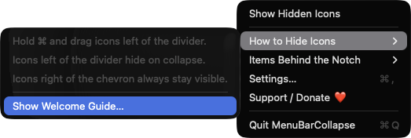
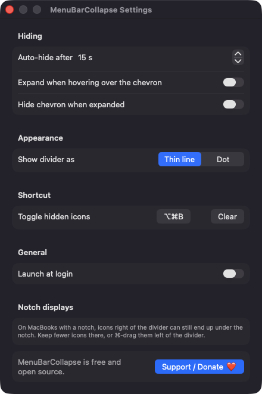
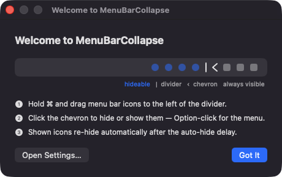

# MenuBarCollapse

**🌐 Website:** [turhe123.github.io/menu-bar-collapse](https://turhe123.github.io/menu-bar-collapse/)

A tiny divider that hides crowded menu bar icons behind a single click and re-hides them automatically.

> 🆓 A free, open-source **Bartender alternative** for macOS 14+. Native Swift, no accounts, no subscriptions, MIT licensed.


[](https://github.com/turhe123/menu-bar-collapse/releases/latest)

## Why

MenuBarCollapse is a free, open-source, 100% native, backend-free alternative to paid utilities in the *Menu Bar Utility* category. It was inspired by Bartender ($16 one-time), the best-known menu bar organizer. MenuBarCollapse is deliberately much smaller: it uses the classic divider technique, with no private APIs, no Screen Recording, no network access and no accounts.

## Features

- **Two status items:** a chevron toggle and an expandable divider. Icons you ⌘-drag to the left of the divider are the ones that get hidden.
- **One-click collapse/expand:** collapsing stretches the divider so everything to its left is pushed off the visible bar. The chevron points left when expanded and right when collapsed.
- **Auto-hide timer:** re-hides the bar after a configurable delay (default 15 s, adjustable in 5 s steps up to 600 s, or Off).
- **Global hotkey:** toggle from anywhere (default ⌥⌘B). You can record your own shortcut or clear it.
- **Expand on hover:** optionally reveal hidden icons when the pointer enters the chevron.
- **Hide chevron when expanded:** optionally remove the chevron while icons are showing. Click the divider or use the hotkey to collapse again.
- **Divider style:** thin line or dot.
- **Quick menu:** right-click or Option-click the chevron for Show/Hide, a how-to submenu, a welcome guide, Settings, Support and Quit.
- **Misordering warning:** if the divider ends up to the right of the chevron, the menu shows "Move the divider to the left of the chevron" and collapsing is refused so the chevron can't hide itself.
- **Launch at login** via `SMAppService`.
- **Safe quitting:** icons are restored when you quit while collapsed.
- **Display-change handling:** state is recalculated when screens change.
- **Crowded-bar notice:** if macOS has no room for the app's own icons, it expands and tells you to remove other menu bar items.
- **First-launch welcome window** with a short guide and a diagram drawn in SwiftUI.
- Runs as an accessory app: no Dock icon.

### Limitations

- It can't see or list other apps' icons, so there is no "items behind the notch" list. The menu says so.
- On notch MacBooks, icons right of the divider can still end up under the notch. Keep fewer icons there, or ⌘-drag them left of the divider.

## Screenshots

<p align="center"></p>

<p align="center"><em>The quick menu, opened by right- or Option-clicking the chevron, with the How to Hide Icons guide expanded alongside Show Hidden Icons, Settings and Support.</em></p>

<p align="center"></p>

<p align="center"><em>Settings for the auto-hide delay, expand on hover, divider style, the global ⌥⌘B shortcut and launch at login.</em></p>

<p align="center"></p>

<p align="center"><em>The first-launch welcome window explains the divider and chevron with a small diagram and three steps.</em></p>

## Install

1. Download `MenuBarCollapse-macOS.zip` from the [latest release](https://github.com/turhe123/menu-bar-collapse/releases/latest).
2. Unzip it and move `MenuBarCollapse.app` to `/Applications`.
3. The app is open source and not notarized, so clear the quarantine flag:

   ```bash
   xattr -cr /Applications/MenuBarCollapse.app
   ```

4. Right-click the app → **Open** the first time.

## Build from source

Requires macOS 14+ and Xcode with Swift 5.9+.

```bash
brew install xcodegen
xcodegen generate
xcodebuild -project MenuBarCollapse.xcodeproj -scheme MenuBarCollapse -configuration Release -derivedDataPath ./build build
```

The app lands at `build/Build/Products/Release/MenuBarCollapse.app`.

## Permissions

MenuBarCollapse does **not** request Accessibility, Screen Recording, Microphone, Camera or any other privacy permission.

- The global hotkey uses Carbon `RegisterEventHotKey`, which needs no Accessibility access.
- Collapsing only changes the length of the app's own status item, so no Screen Recording is needed.
- **Notifications (only if needed):** if the menu bar is too crowded to show the app's icons, it asks to post a one-time notification. If you decline, it shows an alert instead.
- **Login Items (optional):** if you enable Launch at login, macOS may ask you to approve it in System Settings › General › Login Items.

## Support ❤️

If this saves you some menu bar clutter, you can support development:

[Support Or (Leo) Davidai ❤️](https://ko-fi.com/leodavidai)

The app also has a "Support / Donate ❤️" button in its menu and Settings.

## More free Mac apps

MenuBarCollapse is one of [60 free, open-source Mac utilities](https://github.com/turhe123/mac-apps) built the same way: native Swift, no accounts, no telemetry. Browse the full gallery at [turhe123.github.io/mac-apps](https://turhe123.github.io/mac-apps/).

## License

MIT © Or Davidai Bachar
